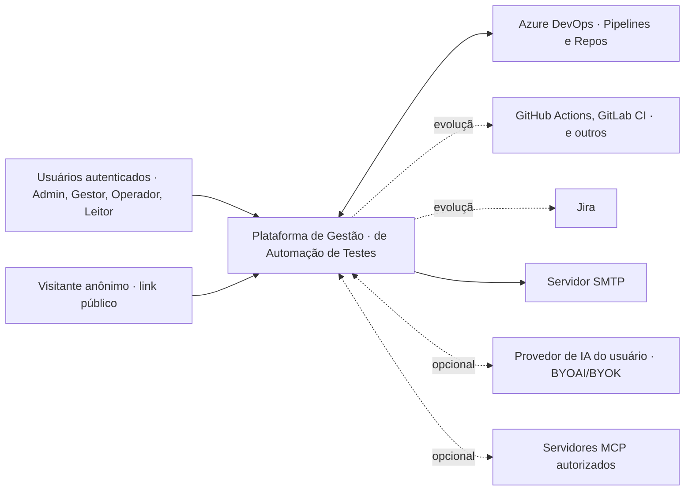
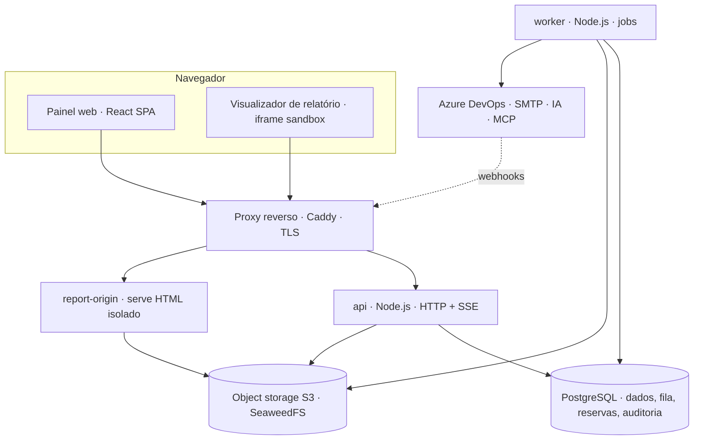
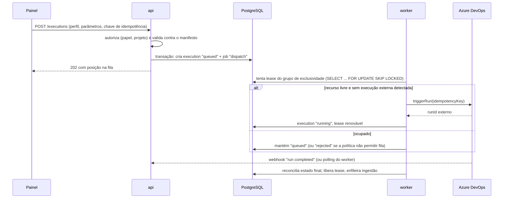

# Arquitetura — Plataforma de Gestão de Automação de Testes

> **Status:** base aprovada em 20/11/2026 (ADR-001 a ADR-010). Ajustes do esqueleto registrados nos ADR-002 e ADR-005.
> **Base:** *Especificação de requisitos — Plataforma de Gestão de Automação de Testes*, versão 1.1, de 20/11/2026, com a precedência do adendo 1.1. A especificação é mantida fora deste repositório; os IDs (RF, RN, DOC, RNF, CA, Q, P) citados aqui são os dela.
> **Convenção:** **[Confirmado]** = decisão ou requisito da especificação; **[Proposta]** = escolha desta arquitetura (aprovada como base, ainda sujeita a ajuste); **[Pendente]** = depende de informação que ainda não temos.

## 1. Resumo da recomendação

- **Forma:** um **monólito modular** em TypeScript com dois processos do mesmo código: `api`, que atende o painel, e `worker`, que faz sincronização, ingestão, notificações e tarefas de IA. Os dois rodam em várias instâncias. **[Proposta]**
- **Persistência:** **PostgreSQL** guarda os dados, a fila de jobs, as reservas de recurso e a auditoria. Um **object storage compatível com S3** (SeaweedFS no self-hosted) guarda relatórios e evidências. **[Proposta]**
- **Extensibilidade:** provedores de CI/CD, processadores de relatório e provedores de IA entram como **pacotes com contrato versionado e capacidades declaradas**. O núcleo não conhece Azure DevOps, GitHub, Playwright nem o caso piloto. **[Proposta]**, apoiada em RF-013, RF-024, RNF-012, RNF-022 e RN-024.
- **Distribuição:** **Docker Compose** self-hosted, com proxy reverso servindo **duas origens**: o painel e um domínio isolado para os relatórios HTML de terceiros. **[Proposta]**, sobre Q-001 **[Confirmado]** e Q-016 (recomendação ainda não homologada).
- **Regras do caso piloto** (máquina exclusiva, regras entre parâmetros) são **configuração do projeto**, não código do núcleo. **[Confirmado]**: §4.1 e §27.2 item 3.

## 2. Contexto



*Figura 1 — Quem usa a plataforma e com quais sistemas ela fala. As linhas tracejadas são evoluções ou caminhos opcionais.*

A fonte de verdade é distribuída (Q-015 **[Confirmado]**):
- **No provedor:** a definição da pipeline e o estado operacional da execução.
- **Na plataforma:** organizações, projetos, perfis, políticas, recursos, resultados normalizados, links e auditoria.

## 3. Alternativas comparadas

### 3.1 Forma do sistema

| Critério | A. Monólito modular (api + worker) | B. Microsserviços | C. Serverless/gerenciado |
|---|---|---|---|
| Instalação self-hosted (Q-001, RNF-032) | Simples: poucos containers | Complexa: muitos serviços, malha e observabilidade distribuída | Incompatível: depende de nuvem proprietária |
| Escala de referência (Q-014: 1.000 execuções/dia, 50 usuários) | Sobra folga | Exagero para o volume | Atende |
| Escala horizontal do processamento (RNF-004) | Workers replicáveis | Atende | Atende |
| Isolamento de falhas | Por processo (api × worker) | Por serviço | Por função |
| Instalação por terceiros (open source, [ADR-012](adr/ADR-012-open-source-self-hosted.md)) | Simples: um `docker compose up` | Difícil para quem instala: muitos serviços para operar | Inviável: depende de nuvem proprietária |
| Esforço para contribuir no open source (Q-012) | Baixo | Alto | Médio |

**Recomendação: A.** A desvantagem é que módulos podem se acoplar se as fronteiras não forem vigiadas. A mitigação é uma regra de lint/arquitetura que proíbe um módulo de importar o interior de outro (ADR-001).

### 3.2 Stack (P-009)

| Critério | TypeScript (Node.js + React) | .NET (ASP.NET Core + React) | Python (FastAPI + React) |
|---|---|---|---|
| SDK do Azure DevOps | `azure-devops-node-api`, oficial | Client libraries .NET oficiais, as mais completas | Sem SDK oficial mantido no mesmo nível; REST direto |
| SDK do MCP | SDK TypeScript oficial, a referência do protocolo | SDK C# oficial | SDK Python oficial |
| Ecossistema Playwright e k6 | Playwright é TS; tipos do relatório JSON disponíveis; scripts k6 são JS | Playwright .NET existe, mas o relatório JSON é do runner TS | Sem relação direta |
| Uma linguagem em front e back | Sim: contratos e esquemas compartilhados | Não | Não |
| Contribuidores open source | Base ampla | Base ampla, mais corporativa | Base ampla |
| Desempenho para o volume previsto | Suficiente | Melhor, mas sem necessidade | Suficiente |

**Recomendação: TypeScript ponta a ponta.** O motivo principal é compartilhar o esquema do manifesto de configuração (§19.4) entre frontend, backend, conectores e a validação das propostas da IA.

**Desvantagem e incerteza:** .NET teria o SDK de Azure DevOps mais completo. Também não sei quais linguagens o time domina, e isso pode inverter a recomendação. **[Pendente: confirmar com o time]**

### 3.3 Fila de jobs e eventos

| Opção | Componentes a mais | Persistente e reprocessável (RNF-023) | Transação junto com os dados |
|---|---|---|---|
| **Fila no PostgreSQL** (pg-boss ou graphile-worker) | Nenhum | Sim | Sim: o job nasce na mesma transação (outbox) |
| Redis + BullMQ | Redis | Só com persistência configurada | Não |
| RabbitMQ | Broker | Sim | Não |

**Recomendação: fila no PostgreSQL.** Mil execuções por dia geram poucos milhares de jobs, volume trivial para o banco. A troca por um broker fica atrás de uma interface `JobQueue`, caso uma instalação muito grande exija (ADR-004).

## 4. Containers



*Figura 2 — Processos e armazenamentos. Nenhum processo além do worker fala com sistemas externos, exceto o recebimento de webhooks pela api.*

| Container | Responsabilidade | Requisitos atendidos |
|---|---|---|
| `web` | SPA do painel (React + Vite), em pt-BR, responsiva e acessível | RF-071–085, RF-106–118, RNF-014–016 |
| `api` | Autenticação, autorização, casos de uso, consultas, SSE para tempo real, recebimento de webhooks e endpoint público de links | RF-131–140, RNF-007, RNF-003 |
| `worker` | Sincronização com provedores, disparo e cancelamento, reconciliação, ingestão e processadores, retenção, e-mail, sessões de IA + MCP | RF-017, RF-052, RF-086–105, RF-126–130, RF-144, RF-172–187 |
| `report-origin` | Serve HTML de relatórios num **domínio separado**, sem cookies do painel, com CSP restritiva e URLs assinadas de curta duração | RF-088, RNF-024, CA-012 |
| PostgreSQL | Dados de todos os módulos; fila de jobs; leases de recurso; auditoria append-only | RNF-010, RNF-021, RNF-023 |
| Object storage | Relatórios originais, JSON, screenshots, vídeos, traces e logs coletados, com retenção por tipo | RF-096–097, RF-144, R-007, R-009 |

`api` e `worker` são o mesmo pacote de código com pontos de entrada diferentes. `report-origin` é o mesmo código da `api` iniciado com `MODE=report-origin`, que só expõe a rota de relatórios e envia cabeçalhos restritivos.

## 5. Módulos do backend

Cada módulo tem domínio, casos de uso, persistência própria (tabelas com prefixo) e uma API pública interna. A regra é que um módulo nunca lê as tabelas de outro.

| Módulo | Responsabilidade | Dados que possui |
|---|---|---|
| `identity` | Login local (Argon2id), sessões, recuperação de acesso, convites | users, sessions, invites |
| `tenancy` | Organizações, workspaces, projetos, membros, papéis | organizations, workspaces, projects, memberships |
| `access` | Política de autorização (papel × escopo × operação), avaliada no servidor | — (lê memberships por interface) |
| `integrations` | Conexões com provedores, credenciais cifradas, teste de conectividade, registry de conectores | integrations, credentials |
| `pipelines` | Catálogo de pipelines vinculadas, **configuração versionada** (manifesto), perfis, ambientes, regras de validação, edição de definições externas | pipelines, pipeline_config_versions, execution_profiles, definition_changes |
| `resources` | Catálogo de executores, grupos de exclusividade, reservas e leases | resources, exclusivity_groups, reservations |
| `execution` | Pedido, fila, disparo, cancelamento, reexecução, acompanhamento, reconciliação de execuções externas | executions, execution_stages, run_queue |
| `scheduling` | Agendamentos internos, leitura dos agendamentos do provedor, prevenção de duplicidade | schedules |
| `results` | Ingestão de artefatos, processadores, resultados normalizados por categoria | test_results, test_attempts, perf_metrics, artifacts, ingestion_jobs |
| `insights` | Indicadores e dashboards (consultas de leitura e agregações) | dashboards, saved_views |
| `sharing` | Links públicos e autenticados, projeção sanitizada, revogação, prévia | share_links |
| `notifications` | Regras, modelos e envio de e-mail; histórico de envios | notification_rules, notifications |
| `audit` | Registro append-only de operações críticas e consulta | audit_events |
| `assist` | Provedores de IA do usuário, servidores MCP, sessões assistidas, propostas de manifesto | ai_providers, mcp_servers, assist_sessions |
| `admin` | Retenção, limites, saúde e falhas internas, reprocessamento | retention_policies |

O modelo lógico do §9 da especificação é a base. O modelo físico fica para o esqueleto, e depois para a skill `data-modeling` se você quiser detalhar.

## 6. Contratos de extensão

### 6.1 Conector de provedor CI/CD

O contrato é o do §10.1 da especificação, ampliado pelas capacidades de edição do §18 e pelo cancelamento externo de Q-007.

```ts
interface PipelineConnector {
  readonly kind: string;                    // "azure-devops"
  readonly contractVersion: "1";
  capabilities(conn: ConnectionContext): Promise<ConnectorCapabilities>;
  testConnection(conn): Promise<ConnectionCheck>;
  listPipelines(conn, query): Promise<Page<ExternalPipeline>>;
  getPipeline(conn, externalId): Promise<ExternalPipelineDetail>;
  getParameters(conn, externalId, ref?): Promise<ParameterSpec[]>;
  triggerRun(conn, request: TriggerRequest, idempotencyKey: string): Promise<ExternalRunRef>;
  getRun(conn, runRef): Promise<ExternalRunState>;
  listRuns(conn, externalId, since): Promise<Page<ExternalRunState>>;
  cancelRun?(conn, runRef): Promise<void>;
  getLogs?(conn, runRef, stageRef?): AsyncIterable<LogChunk>;
  listArtifacts?(conn, runRef): Promise<ExternalArtifact[]>;
  downloadArtifact?(conn, artifactRef): Promise<ReadableStream>;
  getSchedules?(conn, externalId): Promise<ExternalSchedule[]>;
  getDefinition?(conn, externalId): Promise<DefinitionSnapshot>;   // conteúdo + revisão
  proposeDefinitionChange?(conn, change: DefinitionChange): Promise<ChangePreview>; // diff + validação
  applyDefinitionChange?(conn, change, mode: "api" | "commit" | "pull-request", expectedRevision: string): Promise<AppliedChange>;
  parseWebhook?(headers, body): Promise<ProviderEvent | null>;     // com validação de assinatura
}
```

- Métodos opcionais ausentes, somados ao objeto `capabilities`, dizem à interface o que mostrar. Nada é simulado: RN-044, CA-023, CA-041.
- `expectedRevision` é a trava otimista que barra publicação sobre definição alterada por terceiros: RN-043, CA-032.
- O conector recebe a credencial já decifrada só durante a chamada, e nunca a registra em log: RN-017, RNF-033.

### 6.2 Processador de relatório

```ts
interface ReportProcessor {
  readonly id: string;              // "playwright-json@1"
  readonly category: "functional" | "api" | "performance";
  detect(artifact: ArtifactMeta, sample: Uint8Array): DetectResult;
  process(input: ArtifactStream, ctx): Promise<ProcessorOutput>; // status: processed | partial | unsupported | failed
}
```

- Primeiros processadores: `playwright-json`, `playwright-html` (só preserva e indexa), `junit-xml` e `k6-summary`. O último depende de P-008. **[Confirmado: Q-004]**
- A saída de cada processador fica numa tabela da **sua categoria**. Assim as métricas de k6 nunca entram na taxa de aprovação: RN-045, §20.2.
- Reprocessar é idempotente pela chave `(execution_id, artifact_id, processor_id@versão)`: §20.3, RF-149.

### 6.3 Manifesto de configuração de pipeline

É a representação única que os dois caminhos de onboarding produzem (§19.1 **[Confirmado]**). Também é o formato de importação e exportação (Q-013).

- Esquema em `packages/contracts`, com Zod e um JSON Schema gerado dele, versionado por `schemaVersion`.
- Conteúdo: referência da integração, id externo, parâmetros tipados, **regras de validação declarativas**, recursos exigidos, relatórios esperados e políticas.
- Exemplo de regra de validação, como **dado do projeto**: `when runSmoke = true then browser in [chromium]`. Atende DOC-007, CA-033 e CA-034 sem código do caso piloto no núcleo.
- Segredos nunca entram no manifesto, só referências (`integrationRef`): CA-040, RNF-033.

### 6.4 Provedor de IA e MCP

- `AiProvider` é uma interface mínima de chat com chamada de ferramentas. Adaptadores por provedor ficam em [Pendente: P-004].
- O cliente MCP usa o SDK oficial. Transportes e autenticação dependem de P-005.
- Ferramentas MCP são classificadas como `read` ou `mutate`. A sessão assistida só expõe as ferramentas autorizadas para ela (RF-176), e nunca expõe ferramentas de mutação sem confirmação separada (RF-182).
- A saída da IA é **apenas uma proposta de manifesto**. Ela passa pela mesma validação determinística do caminho manual antes de existir: RN-041, CA-028, CA-044.

## 7. Fluxos críticos

### 7.1 Pedir execução com recurso exclusivo (FLX-002 e FLX-005)



*Figura 3 — O lease é uma linha no banco com validade. Assim a reserva fica consistente com várias instâncias (FLX-005), e um worker que morrer não prende o recurso para sempre.*

- **Execuções externas** (RF-052, RN-007): a sincronização detecta execuções iniciadas direto no provedor e cria um lease do tipo `external`, que também bloqueia o recurso. Até onde isso é detectável depende de P-012. **[Pendente]**
- **Execução sem atualização** (RF-060): se o lease vence sem renovação, a execução vai para `stale`, um alerta é emitido e o reconciliador consulta o provedor antes de liberar o recurso.
- **Duplicidade** (RF-057, CA-022): uma chave de idempotência no pedido, e `external_run_id` único por integração nos eventos.

### 7.2 Ingestão de resultados (FLX-003)

1. O worker lista e baixa os artefatos para o object storage, preservando o original (R-007).
2. Cada artefato passa pelo `detect` dos processadores registrados. Os compatíveis processam o artefato e os outros o marcam como `unsupported`, preservado.
3. Sem artefato, a execução grava `report_status = missing`, sem inventar resultado: RN-012, CA-011.
4. A falha da pipeline antes dos testes vira `failure_kind = infrastructure`: RN-011, CA-025.
5. Fim do fluxo: um evento atualiza os dashboards por SSE e cria os jobs de notificação. O e-mail não bloqueia a conclusão da execução (RN-019).

### 7.3 Editar definição de pipeline (FLX-006)

1. `getDefinition` retorna o conteúdo e a revisão. A interface mostra o editor visual ou técnico conforme `capabilities`.
2. `proposeDefinitionChange` retorna o diff e a validação de sintaxe e esquema (RF-157, RF-158).
3. Ao confirmar, a api reautoriza e o worker aplica com `expectedRevision`, por API, commit ou PR. O padrão entre commit e PR depende de P-006 e P-014.
4. A tela só mostra "publicado" depois de ler de volta a revisão externa (§18.3). Se a confirmação se perder, um job de reconciliação descobre o que realmente aconteceu.

### 7.4 Link público (FLX-004, §22.2)

- O `share_link` guarda **só o hash** de um token aleatório de 256 bits, mais o escopo (dashboard, filtros, período), os campos visíveis, a validade e quem criou.
- O endpoint público `/s/{token}` só lê uma **projeção sanitizada**, montada por uma lista do que pode aparecer, nunca por uma lista do que fica de fora. Ele não carrega logs brutos, variáveis nem artefatos não liberados: RN-046, RN-047, CA-036, CA-037.
- A "prévia do visitante" usa exatamente a mesma projeção.
- Revogar remove o acesso na hora (RN-016) e fica auditado.

## 8. Segurança

| Tema | Decisão | Requisitos |
|---|---|---|
| Isolamento entre organizações | Toda tabela de tenant tem `organization_id`. Os repositórios exigem o contexto de tenant. **Row-Level Security** do PostgreSQL é a segunda barreira. Testes automatizados de isolamento | RN-002, RNF-008, CA-020 |
| Autenticação | Login local, Argon2id, sessão em cookie `HttpOnly`/`Secure`/`SameSite=Lax`, rotação de sessão, limite de tentativas, recuperação por token de uso único. Federação fica atrás de uma interface | Q-011, RNF-026, RF-141 |
| CSRF e XSS | Token CSRF em mutações; CSP restritiva no painel; HTML de terceiros só na `report-origin` em iframe `sandbox` | RNF-024, CA-012 |
| Segredos | Cifragem envelope (AES-256-GCM): chave de dados por organização, cifrada por uma chave mestra vinda do ambiente ou de um KMS. Interface `SecretStore` para trocar por Vault | RNF-006, RN-049, R-006 |
| Webhooks | Validação de assinatura ou segredo compartilhado, conforme o provedor; idempotência por id do evento | §5.1, CA-022 |
| SSRF | Endpoints de provedores e MCP passam por uma lista de bloqueio de redes internas configurável (relevante no self-hosted) | §5.1 |
| IA e MCP | Conteúdo externo é dado não confiável; ferramentas de mutação exigem confirmação; o usuário vê o que será enviado ao modelo | §19.5, CA-043 |
| Auditoria | `audit_events` append-only com autor, ação, alvo, resultado e correlação; sem segredos | RN-020, RNF-021 |

## 9. Qualidade: cenários verificáveis

As metas numéricas vêm da especificação e continuam como proposta (§5 e Q-014).

| Cenário | Estímulo | Resposta esperada | Medida |
|---|---|---|---|
| Atualização em tempo real (RNF-003) | Webhook de conclusão chega | O painel aberto mostra o novo estado | ≤ 15 s até o evento SSE, com webhook ativo; sem webhook, depende do intervalo de polling |
| Consulta comum (RNF-002, RNF-034) | Abrir dashboard do projeto com 12 meses de dados na carga de referência | Resposta da api | p95 ≤ 3 s, com a carga de referência (10 organizações, 100 pipelines, 1.000 execuções/dia, 50 usuários) |
| Worker cai durante uma execução (RNF-023, RN-006) | O processo morre segurando um lease | O lease vence, o reconciliador consulta o provedor e libera ou reatribui o recurso | Nenhum recurso preso além da validade do lease |
| HTML malicioso (RNF-024) | O relatório tenta ler o cookie do painel | O script não tem acesso, por origem distinta e sandbox | Teste automatizado E2E |
| Vazamento entre organizações (RNF-008) | Usuário da organização A pede um id da organização B | 404, e o evento fica auditado | Suíte de isolamento no CI |

## 10. Implantação

```mermaid
flowchart LR
  subgraph Servidor self-hosted · docker compose
    C[caddy · :443 painel · :443 relatórios]
    A[api ×N]
    W[worker ×N]
    R[report-origin]
    D[(postgres)]
    M[(seaweedfs)]
  end
  C --> A
  C --> R
  A --> D
  W --> D
  A --> M
  W --> M
  R --> M
```

*Figura 4 — Implantação de referência. Um servidor interno é o alvo; trocar o SeaweedFS por S3 e o Postgres por um serviço gerenciado serve para instalações maiores. Não há SaaS ([ADR-012](adr/ADR-012-open-source-self-hosted.md)).*

- Configuração 100% por variáveis de ambiente (RNF-011). As migrações de banco rodam num passo `migrate` antes de subir a versão nova (RNF-032).
- Health checks `/health/live` e `/health/ready`; logs JSON com `correlation_id`, `organization_id`, `pipeline_id` e `execution_id` (RNF-013); métricas OpenTelemetry opcionais.
- Backup: `pg_dump` agendado e versionamento ou replicação de bucket (RF-150). RPO e RTO dependem de cada implantação (RNF-017) **[Pendente]**.

## 11. Decisões de arquitetura (ADRs)

| ADR | Decisão | Status | Principal consequência negativa |
|---|---|---|---|
| ADR-001 | Monólito modular com processos `api` e `worker` | Aceita | Exige disciplina de fronteiras entre módulos, verificada por lint |
| ADR-002 | TypeScript ponta a ponta (Node.js 24 LTS, React, monorepo npm workspaces) | Aceita | SDK do Azure DevOps menos completo que o .NET |
| ADR-003 | PostgreSQL como banco único, com RLS para isolamento | Aceita | Agregações pesadas futuras podem pedir réplica de leitura |
| ADR-004 | Fila de jobs no PostgreSQL atrás da interface `JobQueue` | Aceita | Teto de vazão menor que o de um broker dedicado |
| ADR-005 | Object storage S3-compatível (SeaweedFS no self-hosted) | Aceita | Um container a mais para operar |
| ADR-006 | Conectores e processadores com contrato versionado e capacidades declaradas | Aceita | Mais código de contrato antes do primeiro conector |
| ADR-007 | Relatórios HTML servidos em origem separada | Aceita | Exige um segundo hostname ou porta e certificado |
| ADR-008 | Manifesto de configuração como representação única (manual, IA, import/export) | Aceita | Mudanças no esquema exigem migração de versões de manifesto |
| ADR-009 | Leases com validade no banco para recursos exclusivos | Aceita | A validade precisa ser calibrada com a duração real das execuções |
| ADR-010 | Tempo real por SSE, sem WebSocket | Aceita | Só servidor → cliente; suficiente para os requisitos |
| ADR-011 | Acesso local por convite; links de uso único gerados pelo administrador até haver e-mail (P-003) | Aceita | Até o incremento 7 o link é entregue por fora da plataforma |

Cada ADR tem um arquivo em [docs/adr/](adr/), com contexto, opções, decisão, consequências e status.

## 12. Estrutura do repositório

```text
painel-pipelines/
├── apps/
│   ├── api/                 # HTTP, SSE, webhooks, endpoint público
│   ├── worker/              # jobs: sync, dispatch, ingestão, retenção, e-mail, assist
│   └── web/                 # React + Vite
├── packages/
│   ├── core/                # módulos de domínio (identity, tenancy, pipelines, execution...)
│   ├── contracts/           # esquemas Zod/JSON Schema: manifesto, DTOs, eventos
│   ├── connector-sdk/       # interface PipelineConnector + testes de conformidade
│   ├── connector-azure-devops/
│   ├── processor-sdk/       # interface ReportProcessor
│   ├── processor-playwright/
│   ├── processor-junit/
│   ├── processor-k6/
│   └── assist/              # AiProvider, cliente MCP, sessão assistida
├── deploy/compose/          # docker-compose.yml, Caddyfile, .env.example
├── docs/
│   ├── arquitetura.md       # este documento
│   └── adr/                 # ADR-001 … ADR-010
└── .github/workflows/       # lint, typecheck, testes, testes de isolamento
```

O esqueleto tem: estrutura, build e lint, contratos, módulos com fronteiras verificadas, migração inicial de tenancy, identidade e auditoria com RLS, `docker-compose` com health checks, CI e testes de conformidade. **Não tem** regra de negócio implementada nem integração real com o Azure DevOps.

## 13. Rastreabilidade resumida

| Necessidade (especificação) | Responsável na arquitetura | Verificação |
|---|---|---|
| Multi-organização isolada: RF-001–010, RN-002 | `tenancy`, `access`, RLS | CA-001, CA-020, CA-024; suíte de isolamento |
| Conectores substituíveis: RF-011–025, RN-024 | `integrations`, `connector-sdk` | CA-002, CA-003, CA-023; testes de conformidade |
| Onboarding manual e por IA: RF-162–187, RN-038–041 | `pipelines` (manifesto), `assist` | CA-026–029, CA-043, CA-044 |
| Edição de definições: RF-151–161, RN-042–044 | `pipelines`, `connector.applyDefinitionChange` | CA-030–032, CA-035, CA-041 |
| Execução, fila e concorrência: RF-041–060, RN-005–009 | `execution`, `resources` (leases) | CA-005–009, CA-021, CA-022, CA-042 |
| Agendamento híbrido: RF-061–070 | `scheduling` | RN-023; testes de fuso horário |
| Resultados por categoria: RF-086–105, RF-188–194, RN-011–014, RN-045 | `results`, processadores | CA-010, CA-011, CA-025, CA-038, CA-039, CA-045 |
| Dashboards e indicadores: RF-106–118, §8 | `insights` | CA-014 |
| Links públicos e e-mail: RF-119–130, RN-015, RN-016, RN-046, RN-047 | `sharing`, `notifications` | CA-015–018, CA-036, CA-037 |
| Autenticação local e auditoria: RF-131–142, RN-020, RN-048 | `identity`, `audit` | RNF-026; testes de força bruta |
| Retenção e administração: RF-143–150 | `admin`, jobs de retenção | RF-144; testes de expurgo |
| Caso piloto: DOC-001–012 | Manifesto e recursos do projeto piloto, **não** o núcleo | CA-033, CA-034, CA-007 |

**Lacuna visível:** as definições dos denominadores dos indicadores (§8) não existem ainda. A especificação exige essas definições antes de implementar `insights`.

## 14. Plano de entregas

O plano segue a ordem do §25 da especificação, com as investigações que ele exige. Não há estimativas porque não há base medida para elas.

| Incremento | Resultado observável | Depende de | Aceitação |
|---|---|---|---|
| 0. Esqueleto | `docker compose up` sobe tudo saudável; CI verde; contratos compilam | Aprovação desta arquitetura e local do repositório | Health checks OK; teste de conformidade roda |
| 1. Fundação | Login local, organização, workspace, projeto, papéis, auditoria, RLS | 0 | CA-001, CA-020, CA-024 |
| Spike S1: Azure DevOps | Pergunta: quais APIs cobrem parâmetros de YAML, cancelamento, service hooks com assinatura e leitura e escrita de YAML no Repos com as permissões do PAT disponível? Saída: matriz de capacidades confirmada | Acesso a uma organização Azure de teste | Matriz preenchida com evidência de chamadas reais |
| 2. Conector Azure e onboarding manual | Wizard manual, descoberta, manifesto versionado, histórico | 1, S1 | CA-002–004, CA-026, CA-030, CA-040 |
| Spike S2: contrato do caso piloto | Pergunta: quais parâmetros a pipeline do caso piloto vai expor (P-007)? Saída: parâmetros e regras acordados com quem mantém a pipeline | Pipeline do caso piloto | Manifesto do caso piloto validado |
| Spike S4: GitHub Actions | Pergunta: a API do GitHub cobre listar, disparar com o id da execução, acompanhar, cancelar, logs e artefatos? Saída: matriz de capacidades ([S4](spikes/S4-github-actions.md)) | 3 | Confirmado com chamadas reais |
| 3. Execução e concorrência | Perfis, disparo, fila, leases, cancelamento, execuções externas | 2 | CA-005–009, CA-021, CA-022, CA-042 |
| **POC (marco do §12)** | Executar a pipeline do caso piloto, receber o Playwright, ver detalhes, gerar link somente leitura | 3, parte de 4 e 6 | Demonstração ponta a ponta |
| 4. Edição de definição | Diff, validação, publicação por API/PR, caso piloto | 2, S2, P-006 | CA-031–035, CA-041 |
| 5. Relatórios | Playwright JSON/HTML, JUnit, artefatos, dashboards | 3 | CA-010–013, CA-025 |
| Spike S3: formato k6 | P-008: qual saída o pipeline real produz | Pipeline k6 real | Amostra real processada |
| 6. Desempenho k6 | Processador k6, thresholds, dashboard de desempenho | 5, S3 | CA-038, CA-039, CA-045 |
| 7. Distribuição | Links públicos com prévia, e-mail, retenção | 5, P-002, P-011 | CA-015–018, CA-036, CA-037 |
| 8. IA + MCP | BYOAI, MCP, onboarding assistido | 2, P-004, P-005 | CA-027–029, CA-043, CA-044 |

## 15. Pendências que afetam esta arquitetura

| ID | O que falta | Onde afeta |
|---|---|---|
| P-003 | Resolvida para a primeira entrega pelo ADR-011; MFA e federação continuam como evolução (RF-141, RF-142) | `identity` |
| P-004, P-005 | Resolvidas pelo ADR-016 (Anthropic e compatível com OpenAI; MCP por HTTP, ferramentas liberadas uma a uma) | `assist` |
| P-006, P-014 | Commit direto × PR e modelo de aprovação | Fluxo 7.3 |
| P-007 | Contrato real de parâmetros do caso piloto | Manifesto do caso piloto, CA-033 |
| P-008 | Provisória pelo ADR-013 (resumo JSON do k6); confirmar com a pipeline real (spike S3) | `processor-k6` |
| P-012 | Detecção de execuções externas no recurso | Leases do tipo `external` |
| P-002, P-011 | Resolvidas pelo ADR-014 (padrões configuráveis por organização) | Projeção de `sharing` |
| P-010 | Prazos padrão pelo ADR-015; volumes e orçamento reais continuam abertos | Retenção |
| RNF-017 | RPO e RTO | Backup |
| §8 | Denominadores dos indicadores | `insights` |
